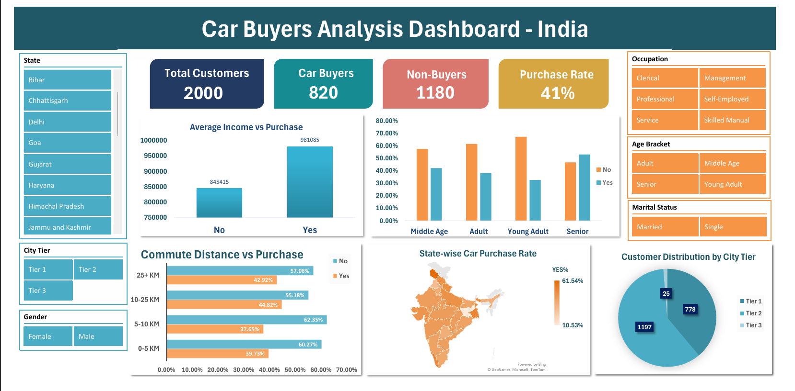

# Car Purchase Analysis – India

An Excel dashboard project exploring customer demographics, income, commute distance and car purchase behaviour using a dataset of 2,000 customer records.

## Project Overview

The aim of this project is to explore customer data and understand how different factors relate to car purchasing decisions.

I used Microsoft Excel to organise the data, perform analysis and build an interactive dashboard that makes the findings easier to explore.

## Dashboard Preview



## Tools & Features

- **Microsoft Excel**
- Data cleaning and organisation
- Excel Tables and formulas
- PivotTables and PivotCharts
- Interactive slicers
- KPI cards
- Excel Map Chart
- Data visualisation

## Dashboard Highlights

The dashboard includes:

- **Total Customers:** 2,000
- **Car Buyers:** 820
- **Non-Buyers:** 1,180
- **Purchase Rate:** 41%

It also explores:

- Average income comparison between buyers and non-buyers
- Purchase behaviour across different age groups
- Car purchases by commute distance
- State-wise car purchase rates
- Customer distribution across city tiers

Interactive slicers allow users to filter the dashboard by state, occupation, age bracket, marital status, gender and city tier.

## Dataset

The project uses a dataset of 2,000 customer survey records.

**Note:** The dataset is synthetic and is used for learning and analysis purposes. It does not represent actual Indian car market statistics.

## Project Structure

```text
Car-Purchase-Analysis-India/
│
├── Car_Purchase_Analysis_India.xlsx
├── dashboard.png
└── README.md
